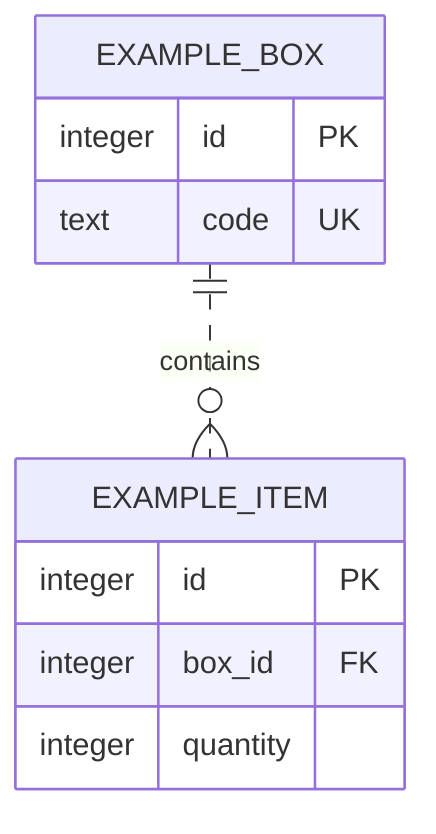

# 0002 · ERD 읽기와 기능별 설계 변화 기록

작성일: 2026-10-27 (Asia/Seoul) · 작업 `04-01~08` · 상태: **04-REVIEW 사용자 확인 완료**. 실제 응답과 기록 시각은 검토 자료에 보존한다.

## 목적과 현재 결정 범위

기능에 필요한 테이블을 그 기능에서 처음 설계한다. 사용자 행동과 행 예시에서 출발해, 컬럼·관계·제약의 이유를 설명하고 실제 적용 전후를 남긴다. 현재 구조는 [erd.md](../erd.md), 변경 기록 규칙은 [erd-history/README.md](../erd-history/README.md)를 따른다. STEP 03의 기술·연결 선택은 [0001](0001-tech-stack.md)과 [환경 안내](../supabase-setup.md)를 유지한다.

이번 결정은 **그림을 읽고 설계 변화를 기록하는 기준**이다. 업무 테이블의 컬럼·관계·삭제 정책은 아직 결정하지 않는다. 현재 실제 public 업무 테이블은 0개이고 관리형 auth.users.id의 PK를 확인했다.

## ERD와 제약을 읽는 순서

ERD(Entity Relationship Diagram)는 테이블과 참조 관계를 그린 그림이다. 테이블은 같은 종류의 데이터를 모으는 단위, 행은 하나의 기록, 컬럼은 그 기록의 항목이다.

| 표시 | 읽는 법 | WHY |
| --- | --- | --- |
| 자료형 | integer·text·uuid처럼 저장할 값의 종류 | 화면 입력의 모양과 DB 저장 형태를 구분 |
| PK · 기본키 | 한 행을 구분. 유일하고 NULL이 없음 | 어떤 기록을 읽고 바꾸는지 식별 |
| FK · 외래키 | 다른 테이블의 키를 참조 | 존재하지 않는 대상을 가리키는 기록 방지 |
| NULL / NOT NULL | 값 없음 허용 / 필수 | 값 부재를 표현할지 결정. 빈 문자열과는 다름 |
| UNIQUE | 값 또는 값 조합의 중복 제한 | 필요한 중복 방지. PostgreSQL 기본값에서는 NULL 여러 개를 허용 |
| CHECK | 행의 값이 조건을 만족하는지 검사 | 범위 제한. 식이 NULL인 경우도 통과하므로 필수 값이면 NOT NULL도 필요 |

FK 컬럼에 NULL을 허용하면 참조가 없는 행도 허용될 수 있다. 키 표기만 보고 필수 관계로 단정하지 않고 NULL 여부를 함께 읽는다. 기준은 [PostgreSQL 17 제약 문서](https://www.postgresql.org/docs/17/ddl-constraints.html)다.

## 문서 전용 가상 예제 · 실제 프로젝트 모델 아님

서랍(BOX)에 물건(ITEM)을 담는 예다. **아래 그림·행·SQL은 설명용이며 DB 실행·migration 생성·적용을 하지 않았다.** 현재 ERD에는 이 예제를 넣지 않는다.



왼쪽 `||`는 한 개, 오른쪽 `o{`는 0개 이상이다. BOX 하나에 ITEM이 0개 이상 들어가고 ITEM은 한 BOX를 가리킨다. ITEM은 자기 id로 식별하고 box_id로 참조하므로 점선으로 표현했다. 문법은 [Mermaid ERD 안내](https://mermaid.js.org/syntax/entityRelationshipDiagram.html)를 따랐다.

| 가상 행 | 값 예 | 읽는 의미 |
| --- | --- | --- |
| BOX | id=1, code=문구 | 1번 서랍 |
| ITEM | id=10, box_id=1, quantity=2 | 1번 서랍을 참조하는 10번 물건 기록 |

```sql
-- 문서용 가상 DDL(구조 정의문). 실행하지 않음.
CREATE TABLE example_boxes (
  id integer PRIMARY KEY,
  code text NOT NULL UNIQUE
);
CREATE TABLE example_items (
  id integer PRIMARY KEY,
  box_id integer NOT NULL REFERENCES example_boxes(id),
  quantity integer NOT NULL CHECK (quantity >= 0)
);
```

그림의 PK/FK/UK만으로 NOT NULL·CHECK까지 모두 알 수는 없어 SQL을 함께 읽는다. 이 예제라면 없는 BOX 참조·음수 수량·NULL 수량·중복 code가 거부될 것으로 예상한다. 이는 **문서 해석에 따른 예상이며 실행한 테스트 결과가 아니다**.

## 입력 → 검증 → 처리 → 결과의 책임

다음은 실제 앱에 추가하지 않은 입력 검증 예다.

```ts
function readQuantity(input: unknown) {
  if (typeof input !== "number" || !Number.isInteger(input) || input < 0) {
    throw new Error("수량은 0 이상의 정수여야 합니다.");
  }
  return input;
}
```

입력 2 → 서버에서 숫자·정수·범위 검사 → 대상에 대한 행동 권한 확인 → DB 처리·제약 검사 → 성공 결과 순서다. -1이나 문자열은 예제 검증에서 거부된다. 서버 검증은 사용자에게 알맞은 오류를 주고, DB 제약은 다른 코드 경로로 들어온 잘못된 저장도 막는다. FK는 대상 존재를 검사하며 그 사용자의 수정 권한까지 판정하지 않는다.

여러 변경이 하나의 동작이라면 트랜잭션으로 묶는다. 예를 들어 두 기록의 수량을 함께 바꾸다가 두 번째가 실패하면 첫 번째도 되돌려야 한다. `BEGIN → 변경 A → 변경 B → COMMIT`, 실패 경로는 `ROLLBACK`이다. 트랜잭션은 여러 변경의 성공/실패를 묶는 장치이며 입력 조건·행동 권한·동시성 정책은 함께 설계해야 한다. [PostgreSQL 트랜잭션](https://www.postgresql.org/docs/17/tutorial-transactions.html)

실제 서버의 인증·대상 권한, GRANT/REVOKE(역할의 접근 권한 부여/회수), RLS(행별 접근 제한)는 기능마다 검증한다. Drizzle 직접 연결에 Auth 사용자의 신원이 자동으로 들어간다고 가정하지 않는다. STEP 05에서 역할별 연결을 준비한다.

## 실제 설계·생성 시점

| 시점 | 그때 처음 다룰 대상 | 현재 상태 |
| --- | --- | --- |
| STEP 05 | Drizzle·migration 도구와 역할별 개발/테스트 읽기 연결 | 도구 준비 예정. 업무 테이블 추가 없음 |
| STEP 06 · 06-API-01 | profiles | 미설계·미생성 |
| STEP 07 · 07-API-01 | posts | 미설계·미생성 |
| STEP 09 · 09-API-02 | comments | 미설계·미생성 |
| STEP 10 · FRIEND/INBOX API 묶음 | 친구 관계·쪽지 | 세부 모델 미설계·미생성 |
| STEP 11 · 11-API-02 | 대화·메시지·필요한 참여자 구조 | 세부 모델 미설계·미생성 |
| STEP 12 선택 심화 | 선택한 범위의 RBAC 모델 | 기존 선택 보류 유지 |

각 기능의 변경 전 → 후보 → 적용·검증 후를 기존 API REVIEW에서 확인한다. 별도 DATA REVIEW나 선행 업무 스키마 승인을 추가하지 않는다. 이미 적용한 migration은 보존하고 수정은 새 migration으로 남긴다. 기존 행이 있으면 데이터 보정·호환성·실패 복구도 그 기능에서 설명한다.

## 면접 질문과 답변 핵심

1. **ERD가 실제 DB와 맞는지 어떻게 아나요?** 읽기 전용 메타데이터 조회·실제 적용 migration·검증 결과를 대조한다. 문서 예제와 적용 전 후보는 현재 ERD에서 분리한다.
2. **서버 검증과 DB 제약이 둘 다 필요한 이유는 무엇인가요?** 서버는 입력 오류·행동 권한을 처리하고 DB는 저장 무결성을 지킨다. 여러 변경의 일괄 성공/실패에는 트랜잭션도 필요하다.

설명은 제공했으며 사용자의 이해·복습 완료는 확인하지 않았다.
