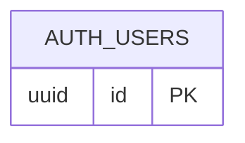

# 현재 ERD · 실제 적용 구조

조사 기록: **2026-10-27 10:02:10 +09:00 (Asia/Seoul)** · 개발 프로젝트 `community-lab-dev` (`awqctedxgsjyqkswogdu`) · PostgreSQL 17.11.

**현재 업무 테이블은 없다.** `public`의 테이블·분할 테이블·뷰·구체화 뷰·외부 테이블 목록이 실제 조회에서 0행이었다. 아래는 Supabase가 관리하는 Auth의 식별자만 표시한 부분 그림이다.

`AUTH_USERS`는 실제 `auth.users`다. 조회한 `id`는 `uuid`·`NOT NULL`이고, `users_pkey = PRIMARY KEY (id)`가 검증된 상태였다. 다른 Auth 컬럼·테이블·관계는 이 그림의 범위에서 생략했다. **연결선이 없는 이유는 아직 우리 업무 테이블을 만들지 않았기 때문**이다. 관리형 Auth 내부에 관계가 없다는 뜻은 아니다.

## 실제 관찰한 범위

| 스키마 | 일반/분할 테이블 수 | 뷰/구체화 뷰 수 | 이번 문서에서의 취급 |
| --- | ---: | ---: | --- |
| public | 0 | 0 | 현재 업무 관계 없음 |
| auth | 27 | 0 | 관리형 Auth. users.id만 상세 확인 |
| extensions | 0 | 2 | 서비스/확장 영역. 상세 모델 생략 |
| graphql | 0 | 0 | 이름과 개수만 관찰 |
| graphql_public | 0 | 0 | 이름과 개수만 관찰 |
| realtime | 3 | 0 | 서비스 영역. 앱의 채팅 구현 완료를 뜻하지 않음 |
| storage | 8 | 0 | 서비스 영역. 앱의 파일 기능 구현 완료를 뜻하지 않음 |
| vault | 1 | 1 | 이름과 개수만 관찰. 저장 값은 조회하지 않음 |

위 수치는 시스템 스키마를 제외한 **관계 메타데이터**다. 사용자 수나 저장 데이터 행 수가 아니다. 함수·트리거·인덱스 전체 목록도 아니며 DB 전체를 그린 완성 ERD로 취급하지 않는다.

## 근거와 다시 확인하기

[읽기 전용 조사 SQL](erd-inspection.sql)을 같은 개발 DB의 SQL Editor 또는 연결된 DBeaver에서 실행할 수 있다. `READ ONLY` 트랜잭션에서 연결 문맥 → 스키마별 개수 → public 관계 → auth.users.id → 실제 PK 정의 순서로 조회한다. 사용자 데이터 행은 읽지 않는다.

실제 실행 결과는 DB/역할 `postgres`, `read_only=on`, public 목록 0행, id `uuid`·not_null/PK true, users_pkey validated true였다. CLI의 승인된 관리 연결(session)을 사용했고 접속 문자열·비밀번호는 기록하지 않았다. [STEP 04 검토 자료](reviews/step04.md)에 실행 결과·범위를 요약한다.

Auth를 관리하는 주체는 Supabase다. 앱 migration에서 이 스키마를 다시 만들지 않는다. 관리형 객체를 참조할 때의 근거는 [공식 Auth 데이터 안내](https://supabase.com/docs/guides/auth/managing-user-data)와 실제 PK이며, 실제 업무 테이블의 FK·삭제 정책은 해당 기능에서 결정한다.

## 다음 갱신 시점

STEP 05는 도구·역할별 연결 준비다. 첫 업무 테이블을 만드는 STEP 06부터, 실제 migration 적용·검증에 성공하면 이 파일을 갱신한다. 직전 그림·설계 후보·WHY·SQL·검증은 [기능별 변경 기록 기준](erd-history/README.md)에 따라 보존한다. 학습용 가상 예제는 [설계·읽기 기준](decisions/0002-database-design.md)에 따로 둔다.
