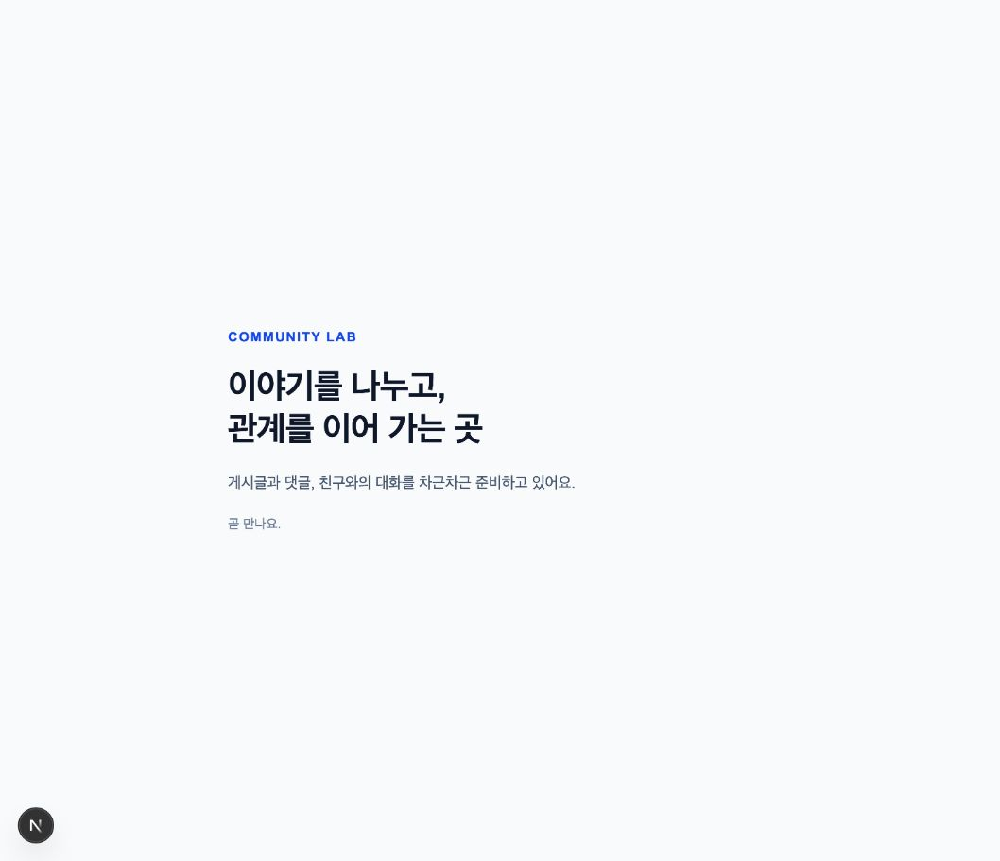

# 02-ENV-REVIEW · 환경·Git 준비 확인

현재 상태: **`02-ENV-REVIEW`·`02-ENV-COMMIT`·`02-GIT-PUSH` DONE** · 작성일: 2026-10-26 (Asia/Seoul). 현재·다음 작업은 `02-UI-01 / IN_PROGRESS`, 다음 사용자 확인은 `02-UI-REVIEW`다.

사용자의 후속 응답 “진행해줘”를 직전 환경 REVIEW 안내·로그인 및 쓰기 권한 검증 완료 문맥에서 환경 범위의 진행 승인으로 해석했다. 실제 말·해석 근거·기록 시각·확인 범위는 7절, 실제 커밋·push 성공은 8절에 기록했다. 아래 최초 검토 자료와 당시 검사 결과는 이력으로 보존한다. 공통 UI는 진행 중이며 아직 사용자 확인·커밋 전이다.

## 1. 확인 범위와 WHY

STEP 01 P-01~P-08 승인·`01-RECORD`를 기록하고 실행 가능한 Next.js 앱, 문서 원본, Git·원격 연결과 실제 검증 결과를 준비했다. 환경 문제가 다음 기능의 API·UI 문제와 섞이지 않게 하는 단계다.

- 실제 앱: `/Users/sungjaechoi/ToyProject/community-lab-workspace/community-lab`
- 기본 화면: [http://127.0.0.1:3001](http://127.0.0.1:3001)
- health: [http://127.0.0.1:3001/api/health](http://127.0.0.1:3001/api/health)
- 정식 [플랜](../work-plan.md)·[진행 기록](../work-status.md)과 STEP 01 문서는 앱 안으로 이관했다. 다음 작업부터 이 앱 폴더를 선택한다.
- 구성·선택 이유·계정 인계 상세: [환경 설정 문서](../development-setup.md).

## 2. 환경 REVIEW 당시 직접 확인 방법

개발 서버는 위 로컬 주소에서 실행 중이다. 종료되었다면 앱 폴더 터미널에서 아래 명령으로 다시 실행한다. 이번에는 환경 변수나 Supabase 계정 없이 실행할 수 있다.

```bash
pnpm dev --hostname 127.0.0.1 --port 3001
```

| 순서·행동 | 기대 결과 | 에이전트가 실제 확인한 결과 |
| --- | --- | --- |
| 1. 기본 화면 주소 열기 | Community Lab 제목과 한국어 준비 문구 | HTTP 200, lang=ko·title·본문 검사 및 브라우저 표시 확인 |
| 2. health 주소 열기 | 200 JSON {"status":"ok"} | 200·JSON content-type·정확한 본문 확인 |
| 3. 아래 POST 요청 실행(선택) | 지원하지 않는 메서드 405 | 실제 POST 405 확인, 데이터 변경 없음 |
| 4. 앱의 docs·AGENTS·README 확인 | 승인된 문서, 정식 플랜·기록, 실행·검증 명령 존재 | STEP 01 문서 6개+플랜 이동 직후 내용 지문 일치, 규칙 병합 확인 |
| 5. 저장소·브랜치·제한 확인 | 아래 원격·push 범위와 미검증 항목이 기대와 일치 | origin 읽기 성공·빈 원격, stage/commit/push 없음 |

```bash
curl -i http://127.0.0.1:3001/api/health
curl -i -X POST http://127.0.0.1:3001/api/health
```

두 curl 명령은 사용자의 재현용 예시다. 에이전트는 Python HTTP 클라이언트로 같은 GET/POST 요청을 실제 검사했다. health는 DB를 사용하지 않아 DB·Auth·전체 서비스 정상 여부를 보증하지 않는다.



위 이미지는 실제 로컬 브라우저 화면이다. 준비 화면이며 공통 내비게이션·기능 UI가 완료되었다는 뜻은 아니다.

## 3. 환경 REVIEW 당시 실제 검증

| 검사 | 실제 결과 |
| --- | --- |
| create-next-app 16.4.3 | 생성·설치·경로 타입 생성 exit 0, 자동 Git 초기화 생략 확인 |
| pnpm typecheck | next typegen + tsc --noEmit, exit 0 |
| pnpm lint | eslint . --max-warnings=0, exit 0 |
| pnpm build | Turbopack 컴파일·TypeScript·정적 페이지 생성 완료, exit 0. /·/_not-found·/api/health 경로 생성 |
| 실제 HTTP | GET / 200, GET /api/health 200 JSON, POST /api/health 405 |
| 브라우저 | Community Lab·한국어 h1·설명 문구 표시, 캡처 저장 |
| 비밀값·생성물 제외 | git check-ignore로 실제 .env 계열 제외·.env.example 허용 확인. staged 파일 없음 |
| 이관·규칙 | 문서 7개 이동 전후 지문 일치. 기존 AGENTS 전체와 생성기 지침 보존 |
| 독립 코드 검토 | 화면·health·타입·CSS·환경 예시·범위 대조에서 수정할 결함 없음. 실행 검사는 위 실제 결과와 구분 |
| 문서·기록 | 최종 링크·상태·플랜·실제 Git 목록 점검은 아래 최종 기록에 명시 |

추가 자동 테스트 파일은 이번 간단한 health/준비 화면에 만들지 않았다. 실제 API·DB·Auth 기능의 자동 검증과 공통 UI·모바일·키보드 검증은 각각 후속 범위다.

## 4. 저장소와 계정 상태

| 항목 | 확인할 실제 상태 |
| --- | --- |
| 대상 | 사용자가 지정한 https://github.com/sungjaechoi/community-lab.git |
| 공개 범위 | GitHub 메타데이터상 public. 신규 공개 설정 변경은 하지 않음 |
| remote | origin HTTPS 등록, git ls-remote·git fetch origin 성공 |
| 기존 이력·현재 원격 | 최초 원격에는 branch/commit ref가 없었다. 첫 push 후 origin/codex/step02-environment에 환경 커밋 반영 |
| 기본 브랜치 메타데이터 | 최초 main → 첫 push 뒤 GitHub API 조회는 codex/step02-environment. 별도 기본 브랜치 변경 명령 없음 |
| 현재 작업·실제 push 브랜치 | codex/step02-environment → origin의 같은 이름 브랜치, upstream 설정 완료 |
| push 허용 정책 | 사용자 실제 답변: “확인 후 커밋하면 지정한 원격 브랜치로 push 허용” |
| 쓰기 인증 | 사용자 로그인 뒤 sungjaechoi 활성 계정·HTTPS·API permissions.push=true 확인. 이후 실제 push 성공도 별도 검증 |
| 로컬 이력 | 환경 첫 커밋 d9b9f8ffdfef542d47c60d24fb6a5f4770cca011, 31개 파일. push 직후 clean 확인 후 공통 UI·후속 문서 작업 중 |

사용자가 CLI 로그인을 완료했고 실제 계정·쓰기 권한을 검증했다. 현재 추가 계정 작업은 없다. 향후 인증이 만료되거나 실패하면 터미널에서 `gh auth login → GitHub.com → HTTPS → Login with a web browser`로 진행한다. 필요한 MFA는 해당 화면에서 처리하고 비밀번호·토큰·인증 코드는 채팅에 보내지 않는다. [조건별 계정 인계](../development-setup.md)를 따른다. 로그인 완료는 환경 REVIEW 승인이나 실제 push 성공과 구분한다.

원격 읽기·로그인·API 쓰기 권한·실제 push 성공을 각각 구분했다. 첫 push 전에 원격 이력과 권한을 재확인하고 허용된 같은 브랜치로 반영했다. 보호 정책·충돌을 강제 push나 검사 해제로 통과시키지 않았다.

## 5. 첫 커밋 대상 확인 당시 자료와 남은 한계

최초 첫 커밋 후보는 앱의 기본 코드·설정·lockfile·README·병합된 AGENTS, 승인된 STEP 01 문서와 정식 플랜·진행 기록, 이번 환경 문서·검토 화면이었다. `02-ENV-COMMIT` 직전 실제 diff·제외 대상을 확인해 아래 범위의 31개 파일을 커밋했다. 이후 성공 해시·진행 상태 기록은 다음 예정 UI 커밋에 포함한다.

| 묶음 | 파일·경로 |
| --- | --- |
| 기본 앱 | src/app/page.tsx·layout.tsx·globals.css·api/health/route.ts, 생성된 favicon·public SVG |
| 설정 | package.json, pnpm-lock.yaml, pnpm-workspace.yaml, tsconfig.json, next.config.ts, eslint.config.mjs, .nvmrc, .gitignore, .env.example |
| 문서 | AGENTS.md, README.md, docs/work-plan.md·work-status.md·requirements.md·screens.md·authorization.md·decisions/0001-tech-stack.md·reviews/step01.md·development-setup.md·reviews/step02-env.md·reviews/assets/step02-env.png |

상위 시작 폴더의 이동 안내는 앱 저장소 밖이다. 비밀 환경 파일·node_modules·.next·생성 타입은 커밋 대상이 아니다.

- 생성기의 ESLint 9.39.5는 지원 종료 경고가 있다. 일부 포함 플러그인의 ESLint 10 지원 선언이 없어 기본 조합을 유지했다. lint는 통과했으나 도구 호환성 갱신은 남은 항목이다. [근거와 한계](../development-setup.md).
- 생성기 pnpm 설정의 native 설치 스크립트 제외는 현재 기기 검증만 통과했다. 다른 OS·이미지 처리까지 검증하지 않았다.
- DB·Supabase·Google OAuth·Realtime·CI·배포·성능·모바일 기능 UI는 미구현/미검증이다. 프로덕션 빌드는 성공했으나 pnpm start 서버 실행은 미검증이다.
- 최초 검토 자료 제출 당시에는 사용자 확인 전이었다. 후속 환경 REVIEW 승인·커밋·push는 완료했고 공통 UI는 진행 중이다. UI 검증·확인·커밋 결과는 아직 기록하지 않는다.

## 6. 최초 제출의 최종 점검·확인 대기 이력

2026-10-26 (Asia/Seoul), 실제 파일·Git을 읽는 Python 일회성 검사 **PASS (exit 0)**:

- 앱 Markdown 11개와 내부 문서/이미지 링크 49개, 상위 이동 안내 3개의 대상 경로 정상.
- STEP 01 승인·기록 완료, STEP 02 환경/Git 준비 13항목 체크, 현재·다음 ID는 02-ENV-REVIEW. REVIEW·COMMIT·PUSH·UI 체크는 비어 있음.
- 기존 요구사항 7개·화면 12개·수용 기준 29개 보존.
- 실제 origin·브랜치 일치, staged 0·commit 0, 환경 파일·생성물 제외 확인. 첫 커밋 후보는 현재 31개 파일이며 5절 범위와 일치.
- 생성기 지침 블록은 한 번만 존재하고 타입 오류 무시 설정은 없음.
- 별도 문서 검토에서 STEP 01 기술 결정의 앱 미구현 표현에 작성 당시라는 시점을 붙여 현재 환경 검증과 구분했다. 나머지 승인·재개·커밋/push·검증 구분은 정합적이었다.

위 검사는 최초 제출 당시 문서·저장소 상태의 검사이며 DB·Auth·기능 동작 검증이 아니다. 당시 코드·문서 내용은 사용자 승인 전이었으며 후속 승인은 아래 7절을 따른다.

- 최초 제출 당시 현재·다음 재개 ID: **02-ENV-REVIEW / WAITING_USER_REVIEW**.
- 최초 제출 당시 환경 범위에 대한 사용자 실제 응답: 아직 없었다. STEP 01 승인과 push 정책 선택을 환경 결과 승인으로 확대하지 않았다.
- 당시 확인 후 순서: `02-ENV-COMMIT → 02-GIT-PUSH`(허용 정책 적용). 최초 요청은 이 REVIEW에서 정지하는 범위로 수행했다.

최초 제출에서는 사용자 요청과 [AGENTS.md](../../AGENTS.md)의 “플랜의 사용자 확인 지점에서는 반드시 멈춘다”는 규칙에 따라 여기서 확인을 기다렸다.

## 7. 후속 사용자 승인·당시 커밋 대기 이력

| 항목 | 실제 기록 |
| --- | --- |
| 사용자 실제 말 | “진행해줘” |
| 승인 해석의 문맥 | 직전 환경 REVIEW 안내와 CLI 로그인·대상 저장소 쓰기 권한 검증 완료 보고 뒤의 응답이다. 현재 대기 중인 환경·Git 준비 범위를 확인하고 해당 커밋·기존 허용 정책의 push를 진행하라는 뜻으로 해석했다. 로그인 완료 보고만으로 승인 처리한 것이 아니다 |
| 확인 범위 | 이 자료의 기본 준비 화면·health·환경 설정·문서 이관·저장소/브랜치·로그인/쓰기 검증·알려진 제한과 첫 커밋 후보. 승인된 STEP 01 문서를 포함하며 새 기능 동작을 추가하지 않음 |
| 기록 시각 | 2026-10-26 16:05:35 +09:00 (Asia/Seoul). clock의 2026-10-26 07:05:35 UTC를 변환 |
| 실제 전송 시각 | 사용자 메시지의 정확한 전송 시각은 별도 제공되지 않음. 기록 시각으로 추정하지 않음 |
| 02-ENV-REVIEW | DONE. 후속 실제 사용자 응답과 위 문맥을 근거로 완료 |
| 승인 기록 문서 점검 | PASS. 변경한 Markdown 3개·상대 링크 9개, 현재/다음 COMMIT APPROVED, REVIEW 완료, COMMIT/PUSH 미체크·UI TODO, 실제 말·시각 구분을 읽기 검사. Git 명령·제품 런타임 재검증은 이 기록 작업에서 수행하지 않음 |
| 승인 기록 당시 현재·다음 재개 ID | 02-ENV-COMMIT / APPROVED(커밋 대기) |
| 당시 다음 실행 순서 | 실제 diff·제외 파일 확인 → 02-ENV-COMMIT → 성공 시 02-GIT-PUSH. 대상 origin/codex/step02-environment, 기존 push 허용 유지 |
| 당시 미완료 | 02-ENV-COMMIT·02-GIT-PUSH는 성공 전이라 완료 표시하지 않았고 공통 UI는 TODO였다. 이후 성공 결과는 아래 8절에 기록 |

이번 승인 기록은 환경 범위의 확인 완료를 뜻한다. 앞서 기록한 실제 검사·미검증·도구 제한과 학습 이해 미확인 상태는 유지한다.

## 8. 환경 커밋·push 실행 결과와 다음 작업

| 항목 | 실제 결과 |
| --- | --- |
| 02-ENV-COMMIT | DONE. d9b9f8ffdfef542d47c60d24fb6a5f4770cca011 |
| 커밋 메시지·범위 | chore: initialize Next.js environment and project docs. 승인된 환경 코드·설정·STEP 01 문서·플랜·검토 자료 31개 파일 |
| 실제 커밋 시각 | 2026-10-26 16:08:33 +09:00. git show의 %cI 출력으로 확인 |
| 02-GIT-PUSH | DONE. git push --set-upstream origin codex/step02-environment exit 0 |
| 원격 결과 | HEAD·upstream·ls-remote 해시가 위 환경 커밋과 동일. origin/codex/step02-environment 추적 설정, push 직후 작업 트리 clean |
| push 정책 | 기존 사용자 허용 “확인 후 커밋하면 지정한 원격 브랜치로 push 허용”을 적용. 같은 확인 범위의 재승인 요청·강제 push 없음 |
| 기본 브랜치 관측 | 최초 main 메타데이터에서 첫 push 뒤 GitHub API default_branch가 codex/step02-environment로 조회됨. 별도 기본 브랜치 변경 명령은 실행하지 않음 |
| 결과 기록 시각 | 2026-10-26 16:09:59 +09:00 (Asia/Seoul), clock 2026-10-26 07:09:59 UTC 변환. 실제 커밋 시각과 구분 |
| 현재·다음 작업 ID | 02-UI-01 / IN_PROGRESS. 공통 레이아웃·메뉴·기본 상태 UI 진행 |
| 다음 사용자 확인 | 02-UI-REVIEW. 공통 UI는 아직 검증·사용자 확인·커밋 전이며 STEP 02 전체 완료가 아님 |
| 후속 기록 처리 | 이 성공 해시·push 결과를 기록한 문서 변경은 다음 예정 02-UI-COMMIT에 포함. 해시 기록용 재커밋은 만들지 않음 |
| 후속 문서 점검 | PASS. 수정한 Markdown 5개·상대 링크 23개, 환경 REVIEW/COMMIT/PUSH DONE, 현재·다음 UI-01 IN_PROGRESS, UI REVIEW/COMMIT 미체크, 전체 해시·실제 커밋 시각과 기록 시각의 구분 확인. 이 문서 갱신 작업에서는 stage·commit·push를 실행하지 않음 |

push 직후 clean은 당시 상태다. 이후 공통 UI 코드와 이 후속 문서가 수정되고 있으므로 현재 작업 트리까지 clean이라고 기록하지 않는다. 환경 단계의 검증을 새로운 UI 변경의 검증 성공으로 자동 승계하지 않는다.
