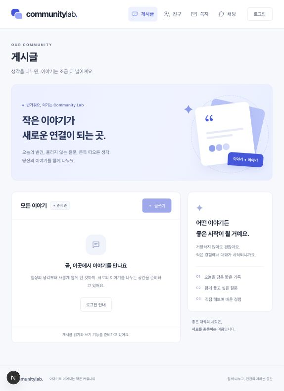
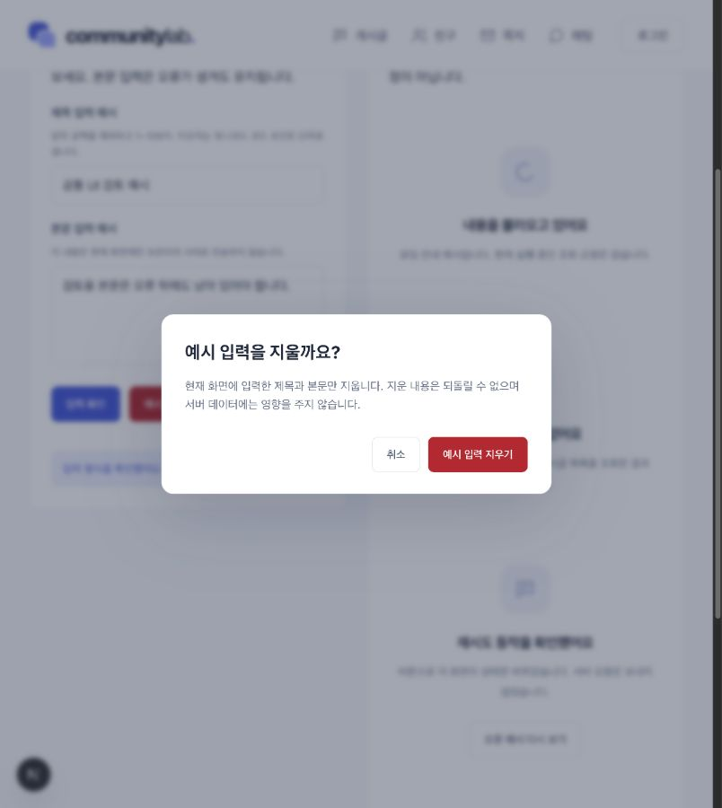

# 02-UI-REVIEW · 공통 화면 확인

현재·다음 ID: **02-UI-REVIEW / WAITING_USER_REVIEW** · 작성일: 2026-10-26 (Asia/Seoul)

공통 UI 구현·검증을 준비했으며 **이번 UI 범위의 사용자 확인·UI 커밋은 아직 없다.** 환경 커밋 `d9b9f8f`와 push 완료를 UI 승인으로 확대하지 않는다. [설계·WHY·작은 코드·학습 자료](../ui/foundation.md)와 [진행 기록](../work-status.md)을 함께 본다.

## 확인 범위와 WHY

헤더·메뉴·현재 위치·본문·푸터, 준비 화면 5개, 버튼·입력·확인창·상태 표현과 모바일 배치를 확인한다. 이후 기능을 연결할 공통 틀을 먼저 맞추어 기능마다 탐색·오류 동작이 달라지는 문제를 줄이기 위한 범위다.

실제 API 연결은 기존 health뿐이다. 게시글·친구·쪽지·채팅·Google 로그인은 준비 상태이며 해당 업무 API·DB·Auth·Realtime을 연결하지 않았다. 가짜 회원·게시글 데이터나 새 의존성은 추가하지 않았다.

## 접속과 직접 확인 순서

현재 개발 서버는 [게시글 준비 화면](http://127.0.0.1:3001/posts)과 [개발용 공통 요소 화면](http://127.0.0.1:3001/ui-preview)을 제공한다. 서버가 종료되었다면 앱 루트 터미널에서 아래 명령으로 다시 시작한다.

```bash
pnpm dev --hostname 127.0.0.1 --port 3001
```

| 순서·사용자 행동 | 기대 화면·동작 | 실제 확인 |
| --- | --- | --- |
| 1. `/`를 열고 게시글 화면 확인 | `/posts` 이동, 밝은 배경·공통 헤더·준비 안내. 글쓰기는 비활성 | 프로덕션 307 이동, 준비 화면과 한국어 안내 확인 |
| 2. 친구→쪽지→채팅→로그인 이동 | 선택한 메뉴와 현재 위치 표시 일치. 각 화면은 준비 안내 | 브라우저 이동·보이는 `aria-current` 일치 확인 |
| 3. 새 진입에서 Tab→Enter | 본문 바로가기가 나타나고 본문으로 초점 이동 | main 초점 이동 확인 |
| 4. 좁은 화면에서 메뉴 열기→Escape | 메뉴 펼침 안내, 닫으면 메뉴 버튼에 초점 복귀 | `aria-expanded` true→닫힘·버튼 초점 복귀 확인 |
| 5. 모바일 메뉴에서 친구 선택 | 친구 화면 이동, 열린 메뉴 닫힘 | 경로·메뉴 닫힘 확인 |
| 6. `/ui-preview`에서 본문만 입력→입력 확인 | 제목 오류·초점, 본문 보존 | 빈 제목과 `aria-invalid`·초점·입력 유지 확인 |
| 7. 제목 101자→다시 확인, 정상 제목→확인 | 길이 오류. 정상일 때 약 1초 처리 중·중복 클릭 방지→저장 없는 완료 안내 | 오류 거부, disabled·`aria-busy`·완료 문구 확인 |
| 8. 오류 예시의 다시 시도 | 예시 상태만 변경 | 실제 요청 없이 상태 변경 확인 |
| 9. 예시 입력 지우기→취소/Escape | 취소 첫 초점, 내용 유지·열었던 버튼 복귀 | Tab/Shift+Tab 순환, Escape·Enter 취소·복귀 확인 |
| 10. 다시 지우기→Tab→Enter 확인 | 현재 예시 제목·본문만 비워짐 | 입력 비워짐·열었던 버튼 초점 복귀 확인 |

검토 화면은 로컬 상태 예시다. 로딩·빈 결과·오류·권한 없음은 실제 서버 응답이 아니며 “재시도”도 네트워크 요청을 보내지 않는다. 이 검사를 실제 권한·API 실패·DB 삭제 검증으로 기록하지 않는다.

## 실제 화면 자료





두 이미지는 브라우저의 기본 CSS clientWidth 803px에서 저장한 실제 화면이다. 넓은 화면·모바일 배치는 아래처럼 실제 CSS 크기와 동작으로 별도 검사했다. 모바일 이미지는 첨부하지 않았다.

## 실행한 검사와 실제 결과

| 검사 | 실제 결과·한계 |
| --- | --- |
| `pnpm typecheck` | exit 0 |
| 최종 `pnpm lint` | exit 0 |
| 최종 `pnpm build` | 색상·검토 화면 제목 보완 후 exit 0. 프로덕션 컴파일·타입 검사 포함 |
| 프로덕션 서버 | `pnpm start`로 3001번 실행. `/` 307→`/posts`, `/posts`·`/friends`·`/inbox`·`/chats`·`/login` 200·한국어 준비 안내 |
| 프로덕션 노출 범위 | `/ui-preview`·`/does-not-exist` 404. 검토 화면은 개발 환경에서만 제공 |
| health 회귀 확인 | GET `/api/health` 200·정확한 `{"status":"ok"}`, POST 405 |
| 개발 서버 복귀 | 프로덕션 정상 종료 후 개발 서버 3001 실행. `/posts`·`/ui-preview` 200, 검토 본문과 robots `noindex, nofollow` 실제 확인 |
| 실제 CSS 너비 | innerWidth 1280/clientWidth 1269, 814/803, 360/349에서 scrollWidth가 clientWidth를 넘지 않음 |
| 모바일 배치 | 검토 화면 한 열 315px, 확인창 좌우 18~331px이 clientWidth 349px 안에 위치. 버튼 높이 44px |
| 메뉴·키보드·입력·확인창 | 위 직접 확인 표의 이동·초점·입력 보존·처리 중·취소·확인 동작 통과 |
| 대비 보완 | 보조 글자 `#667085`/흰 배경 약 4.97:1. 이전 상태 설명·힌트의 낮은 대비를 수정했으며 전체 WCAG 준수를 뜻하지 않음 |

실제 CSS 크기를 기준으로 기록했으며 검사 뒤 브라우저 화면 크기 설정을 원래대로 돌렸다. 최종 링크·플랜·상태 기록 검사는 메인 진행 기록에 별도로 남긴다. 문서 작성 자체를 제품 검사 성공으로 보지 않는다.

## 변경 범위와 아직 확인하지 않은 것

| 구분 | 대상 |
| --- | --- |
| 공통 틀 | `src/app/layout.tsx`·`globals.css`·`page.tsx`, `src/components/app-header.tsx` |
| 화면·상태 | posts·friends·inbox·chats·login·loading·error·not-found, page-heading·feature-preparation |
| 기본 요소·검토 화면 | `src/components/ui/`의 button·text-field·confirm-dialog·state-panel, `src/app/ui-preview/` |
| 문서·근거 | 이 자료·foundation.md·관련 진행/플랜/환경 기록·README·검토 이미지. 환경 성공 해시 후속 기록도 다음 예정 UI 커밋에 포함 |

- `/ui-preview`는 일반 메뉴에 노출하지 않고 개발 환경 외에는 404다. 제목·robots 설정은 검색 노출을 줄이는 보조 설정이다.
- 실제 오류 경계에 장애를 주입한 재시도, 실제 데이터 로딩·실패·빈 DB·권한 거부는 미검증이다. StatePanel 샘플 검토와 구분한다.
- 실제 휴대 기기·모든 브라우저·전체 접근성 준수·업무 API·DB·Supabase Auth·Realtime·배포·성능은 미검증이다.
- 이번 UI의 자동 검사 통과는 사용자 확인과 별개다. 기존 환경 결과나 사용자의 침묵을 이번 UI 승인으로 취급하지 않는다.

## 확인 대기와 다음 작업

확인할 항목은 배치·메뉴 이동·모바일 메뉴·키보드·필드 오류·처리 중 표시·예시 지우기 확인창·준비 상태의 적합성이다. 수정 요청이 있으면 같은 `02-UI-REVIEW`에서 수정·재검증하고 다시 제시한다.

- 실제 UI 사용자 응답·확인 시각: 아직 없음. 학습 설명은 제공했으나 사용자의 이해·복습 완료는 확인하지 않음.
- 현재·다음 재개 ID: **02-UI-REVIEW / WAITING_USER_REVIEW**.
- 사용자 확인 뒤: **02-UI-COMMIT**. 확인된 UI 변경과 환경 성공 결과의 후속 문서를 함께 검토해 커밋한다.
- 커밋 성공 뒤: **03-SETUP-01**. 실제 커밋 해시와 정해진 push 정책 결과를 따로 기록한다.

사용자 요청과 [AGENTS.md](../../AGENTS.md)의 “플랜의 사용자 확인 지점에서는 반드시 멈춘다”에 따라 여기서 확인을 기다린다.


## 후속 사용자 확인 기록 · 2026-10-27

- 실제 응답: “변경된 플랜 확인했어. 02-UI-REVIEW도 확인했으니 커밋·push하고 STEP 03 진행해줘. 내가 해야 할 계정 작업은 구체적으로 안내하고, 03-REVIEW에서 멈춰줘.”
- 정확한 메시지 전송 시각은 제공되지 않음. 승인 기록 시각: 2026-10-27 08:36:14 +09:00 (clock UTC 변환).
- 공통 UI와 개정 3 플랜 승인으로 `02-UI-REVIEW` DONE. 위 확인 대기 문단은 최초 제출 당시의 이력이다. 이해·복습 완료와 구분한다.
- 승인된 UI·개정 플랜·후속 문서의 `02-UI-COMMIT` 및 허용된 같은 브랜치 push를 진행한 뒤 STEP 03을 수행한다. 다음 확인 지점은 `03-REVIEW`다.

후속 실행 결과: `02-UI-COMMIT` DONE. `50c7f91ac1d518f47a73bb7ddc6877f5bdb182eb`, Git 시각 2026-10-27 08:36:59 +09:00, 승인 범위 33개 파일. `git push origin codex/step02-environment` exit 0·원격 해시 일치·직후 clean 확인. STEP 03의 새 변경은 이 승인 범위와 구분하며 현재 [준비 결과](step03.md)를 따른다.
