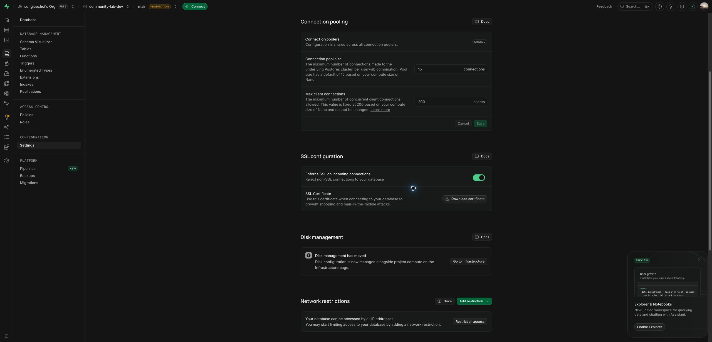
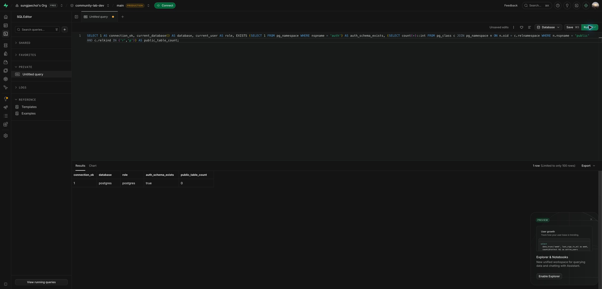
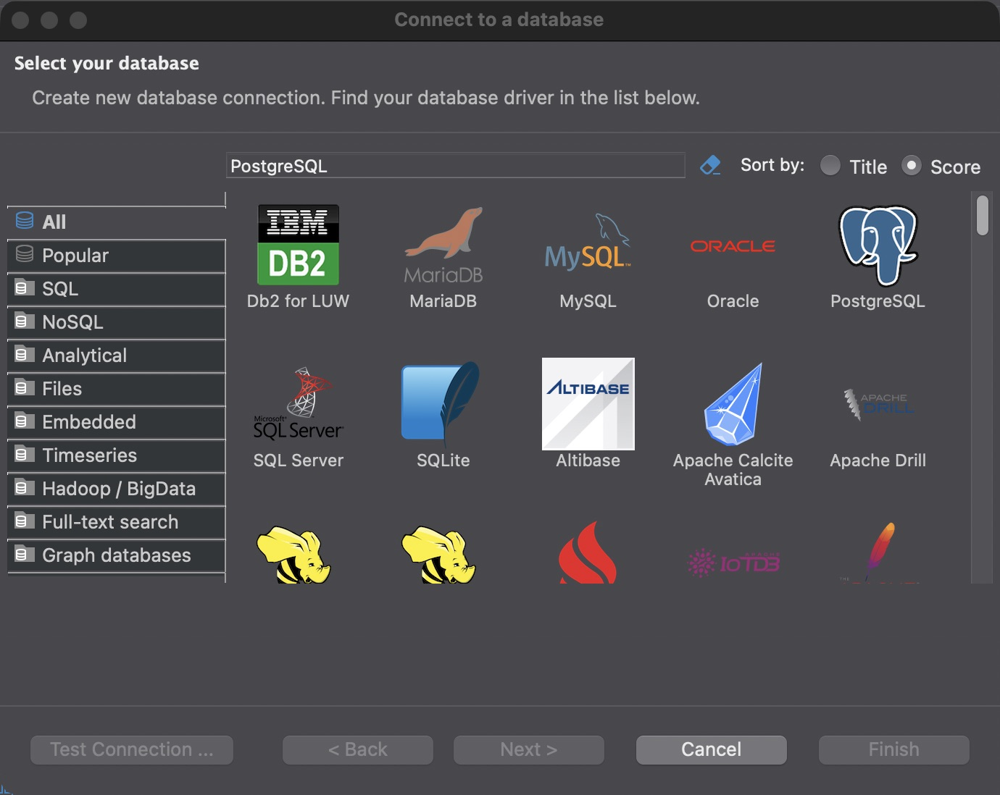

# STEP 03 검토 자료 · 개발 DB와 분리 테스트 기반

작성일: 2026-10-27 (Asia/Seoul). **개발 DB·Next.js·분리 테스트 DB/Auth의 실제 읽기를 확인했고 DBeaver Test Connection 성공·Finish도 사용자 보고로 확인했다.** 후속 응답으로 `03-REVIEW` 전체 승인을 받았다. 아래 제출 당시 자료·검증 한계는 이력으로 보존하며 커밋·push 결과는 성공 후 별도로 기록한다.

## 현재 결과와 직접 확인 방법

전체 실제 응답: “03-REVIEW 전체 확인했어. 커밋·push하고 STEP 04 진행해줘. 04-REVIEW에서 결과를 보여주고 멈춰줘.” 승인 기록 시각은 2026-10-27 09:57:34 +09:00이며 정확한 전송 시각은 제공되지 않았다. `03-REVIEW` DONE, `03-COMMIT` APPROVED로 기록하고 승인 범위의 커밋·허용된 같은 브랜치 push 뒤 STEP 04를 진행한다. 같은 범위의 커밋·push 허가를 다시 묻지 않는다.

| 구분 | 실제 결과·확인 방법 |
| --- | --- |
| 개발 대상 | community-lab-dev·서울·Free·awqctedxgsjyqkswogdu. 사용자가 생성, 실제 Healthy·Owner 확인 |
| 입력 도구 오류 해결 | 두 DB 주소에 비밀번호 값이 이미 있어 기존 덮어쓰기 방지가 작동했다. 공개키 형식 정상·두 값 동일함을 값 출력 없이 확인. 이미 입력된 경우 안내 후 exit0로 수정·기존 파일 보존 |
| 설정 검사 | `pnpm env:check` exit0. 같은 개발 프로젝트의 runtime transaction / migration session 주소 확인 |
| 두 DB 실제 접속 | `pnpm db:check` exit0. 둘 다 DB/역할 postgres·readOnly true·clientTlsVerified true·backendTls true |
| Next.js 실제 접속 | 개발 서버의 http://127.0.0.1:3001/api/dev/db-check → 200 `{"status":"ok"}`. 서버 전용 코드가 읽기 쿼리를 실행하며 DB 주소·역할·키는 HTTP로 반환하지 않음 |
| 공개 health | /api/health → 200 `{"status":"ok"}` 유지. 이 응답만으로 DB 접속 성공을 판정하지 않음 |
| TLS 실패·해결 | 처음 SELF_SIGNED_CERT_IN_CHAIN. 대시보드가 제공한 공식 Supabase Root 2021 CA 적용·검증 유지로 해결. 추가로 SSL 강제를 켜고 잠시 DB 재시작한 뒤 두 구간 TLS true를 재확인 |
| SQL Editor | 1·DB/역할 postgres·Auth 스키마 존재·public 업무 테이블0 실제 확인 |
| DBeaver | 안내 후 사용자가 SSL 선택/다운로드·Test Connection 성공·Finish 완료를 보고. 사용자 수행 결과로 확인했으며 별도 수동 SQL·세부 SSL 설정의 에이전트 재검사는 미수행 |
| 분리 테스트 기반 | Docker27.3.1·Supabase CLI2.122.0, community-lab-test 전용 스택. API54321·DB54322·메일함54324 모두 실제 127.0.0.1 바인딩 확인 |
| 테스트 DB/Auth | `pnpm test:env:check` exit0. local-test·DB/역할 postgres·Auth 스키마 true·Auth 설정 HTTP200·읽기 전용 true. 개발 DB와 다른 대상 |
| 재시작 재현 | test:env:start → check → stop → start → check 모두 exit0. CLI의 기본 서버 키 출력은 메모리에서 처리하고 필요한 값만 제외된 .env.test.local에 반영 |
| 초기 접근 설정 | Data API 노출·자동 공개 끔·ensure_rls 및 기본 ACL 실제 조사. 기능에서 첫 테이블을 만들 때 명시적 REVOKE/GRANT/RLS 적용·검증 계획 보존 |
| Git·비밀 | STEP03 미커밋·staged0. .env.local·.env.test.local·인증서·로컬 CLI 제외. DB 비밀번호·서버 키·전체 URI를 기록하지 않음 |

설정 검사 10개와 입력 도구의 별도 4가지 보존/출력 검사가 통과했다. 타입·린트·빌드도 통과했으며 세부 최종 결과는 진행 기록을 따른다. 실제 역할 분리는 STEP 05, Google 로그인·업무 테이블과 권한 검사는 해당 기능에서 수행한다. 설명 제공과 사용자의 이해 완료는 구분한다.

## 이번에 확인할 항목

1. 입력 도구에 이미 값이 있으면 재입력 없이 보존한다는 안내와 개발 DB의 실제 연결 결과.
2. 런타임 transaction / 관리·migration session의 용도, 공식 CA와 SSL 강제 설정.
3. SQL Editor·앱의 실제 읽기와 DBeaver Test Connection의 사용자 확인을 구분한 결과·검증 한계.
4. 로컬 테스트 DB/Auth의 분리·시작/중지 명령·개발 DB 주소 거부. 상세는 [테스트 기반 안내](../../test-infra/README.md).
5. 업무 테이블을 해당 기능에서 설계·생성하고 ERD를 갱신하는 기존 플랜 유지.

현재·다음 재개 ID는 **03-REVIEW**이며 전체 확인 후 ID는 **03-COMMIT**이다. DBeaver 연결 보고는 기록했고, STEP 03 전체 결과를 확인받은 뒤 커밋한다. 사용자 확인 전에는 STEP 04로 진행하지 않는다.

후속 실제 응답: “SSL 선택할때 다운로드 했고 Test Connection 이상없어서 피니쉬 눌렀어”. 결과 기록 시각은 2026-10-27 09:51:09 +09:00이며 정확한 전송 시각은 제공되지 않았다. 이 응답은 DBeaver 확인 범위로 기록했고 STEP 03 전체 승인으로 확대하지 않았다.

## 이번 범위와 WHY

사용자가 개정 플랜과 `02-UI-REVIEW`를 확인해 UI·문서 33개 파일을 커밋·push했다. 커밋은 `50c7f91ac1d518f47a73bb7ddc6877f5bdb182eb`, Git 시각은 2026-10-27 08:36:59 +09:00이다. 원격의 같은 브랜치 해시 일치·직후 clean을 확인했다. 이 후속 결과 기록은 다음 예정 `03-COMMIT`에 포함한다.

STEP 03에서는 개발 DB의 입력·접속·서버 실행을 따로 검증한다. 스크립트가 입력이 없는데 기본 DB로 접속하거나, 접속 오류에 비밀값을 출력하는 일을 막는 것이 이번 로컬 준비의 목적이다. 실제 업무 테이블·ERD·migration은 아직 없다.

## 초기 준비 당시 검사 이력

| 구분 | 기대 | 실제 |
| --- | --- | --- |
| 계정·프로젝트 | 개발 대상·조직·지역·권한 식별 | sungjaechoi·개인 Free 조직·Owner 확인. 사용자 생성 뒤 community-lab-dev·awqctedxgsjyqkswogdu·서울·Healthy 확인. 기존 프로젝트 변경 없음 |
| 로컬 환경 파일 | 실제 파일 제외·예시만 추적 | `.env.local` 0600·실제 공개값/주소 반영, DB 비밀번호 자리표시자. `.env.local`·`.env.test.local`·`.secrets/root.crt` ignore 확인, 추적 env는 `.env.example`만 |
| 설정 단위 검사 | 잘못된 설정·비밀 출력 차단 | `pnpm test:setup` 7/7 통과. 누락·secret/public 혼동·프로젝트/포트·migration 모드·TLS 옵션·URI 인코딩·오류 숨김 검사 |
| 타입·린트·빌드 | 코드가 설치된 환경에서 처리됨 | `pnpm typecheck`, `pnpm lint`, `pnpm build` exit 0. DB 자격 증명 없이 빌드 성공 |
| CLI 설정 검사 | 입력과 연결을 구분 | 초기 `ENV_MISSING`, 실제 공개값/주소 반영 뒤 `pnpm env:check` exit 1·두 대상 `ENV_INVALID`. 비밀번호 자리표시자로 접속 전 거부 |
| CLI DB 검사 | 런타임·migration 실제 읽기 성공 | 초기 `pnpm db:check` exit 1·`ENV_MISSING`. 비밀번호 입력 대기로 실제 DB 인증·로컬 SQL 실행 미수행 |
| 개발 Next.js | 같은 서버 환경에서 별도 확인 | `/api/dev/db-check` 503·`ENV_MISSING`, no-store·noindex 확인. 접속 성공은 아님 |
| 프로덕션 경계 | 진단 경로 노출 안 함 | 별도 3002 서버에서 진단 404·본문 없음, `/posts` 200·health 200 확인. 검사 뒤 해당 서버만 종료 |
| 기존 health | DB 메타데이터 없는 HTTP 상태 | 개발·프로덕션 `200 {"status":"ok"}`. DB·호스트·역할·키 없음 |
| SQL Editor·DBeaver | 같은 개발 대상에서 읽기 성공 | SQL Editor 1·postgres·postgres·Auth 존재·public 테이블0. DBeaver CE26.0.0 설치·실행·통계 전송 끔, 실제 DB 접속은 미검증 |
| 분리 테스트 DB·Auth | 개발·운영과 다른 대상 | 미준비. Docker 엔진에 접속 실패; 로그인 후 별도 프로젝트/로컬 방식 결정 필요 |
| Data API·기본 권한 | 실제 설정·DB 권한 조사 | 활성·graphql_public/public 노출·자동 공개 끔, ensure_rls 트리거 O 확인. postgres 소유 기본 ACL의 Dxtm 잔존을 조사·기능별 명시적 REVOKE/GRANT/RLS 계획 기록 |
| 공개키·서비스 읽기 | 유효/무효 키·HTTP 경로 구분 | 실제 키 Auth settings200·잘못된 키401. 없는 업무 테이블 점검 GET404·PGRST205(생성 없음). REST 루트401은 별도 결과로 기록 |
| 비밀 입력 도구 | 터미널에 입력을 되비추지 않음 | env:configure 준비·문법/린트 통과, 비대화형 실행은 exit1로 거부. 사용자 실제 입력 성공은 대기 |

처음 스크립트 실행 중 환경 로더 import·모듈 형식 호환 문제를 발견해 수정했다. 최종 CLI와 Next.js 양쪽에서 동일한 `ENV_MISSING` 분류를 확인했다. 설치 시 기존 ESLint 지원 종료 경고와 esbuild 설치 스크립트 제외 안내가 있었지만 현재 기기의 tsx·타입·린트·빌드는 동작했다. 다른 OS나 향후 설치도 검증했다는 뜻은 아니다.

## 초기 사용자 인계 이력

구체적인 화면·필드·WHY·완료 기준은 [Supabase 설정 안내](../supabase-setup.md)를 따른다.

1. 로그인·“신규” 선택·프로젝트 생성은 실제 확인했다. 새 DB 비밀번호 입력·생성 제출은 사용자가 직접 처리했다.
2. 공개값·실제 접속 주소는 반영했다. 직접 연 터미널에서 `pnpm --dir /Users/sungjaechoi/ToyProject/community-lab-workspace/community-lab env:configure`를 실행해 생성 때의 DB 비밀번호를 두 번 입력한다. 입력은 표시되지 않는다. 완료 후 “환경값 입력 완료”만 알려 주며 비밀값은 보내지 않는다.
3. 에이전트는 실제 설정 검사 → 런타임·migration 각각 읽기 → Next.js 읽기를 실행한다. 호스트·역할·TLS는 비밀을 제거해서 기록한다.
4. SQL Editor·DBeaver의 읽기 결과를 확인하고 분리 테스트 대상·Data API 노출/기본 권한의 실제 상태를 조사한다.
5. 필수 연결이 확인되면 실행 방법·기대/실제 결과·한계를 갖춘 `03-REVIEW`를 제시하고 멈춘다.

위 단계는 입력 전 인계 이력이다. 사용자가 명령의 의미를 질문해 목적·한 줄 명령·숨김 입력을 다시 설명했고, 후속 오류 조사에서 실제 값이 이미 입력된 것을 확인해 기존 값을 보존하고 연결을 검증했다. 이해 완료를 추정하지 않으며 현재 결과와 재개 ID는 문서 맨 위를 따른다.

## 정식 03-REVIEW에서 확인할 항목

- 실제 개발 프로젝트 이름·용도·지역, Project URL과 DB URI의 대상 일치.
- runtime·migration·관리 연결 방식과 역할, 실제 성공 결과·TLS 검증.
- 공개 환경값/서버 비밀 구분과 Git 제외, 프로덕션 진단 경로 404.
- SQL Editor·DBeaver·테스트 DB/Auth·Data API의 완료/남은 작업.
- 설정·오류의 WHY와 [면접 질문](../supabase-setup.md#학습-확인). 설명 제공과 이해 완료는 구분한다.
